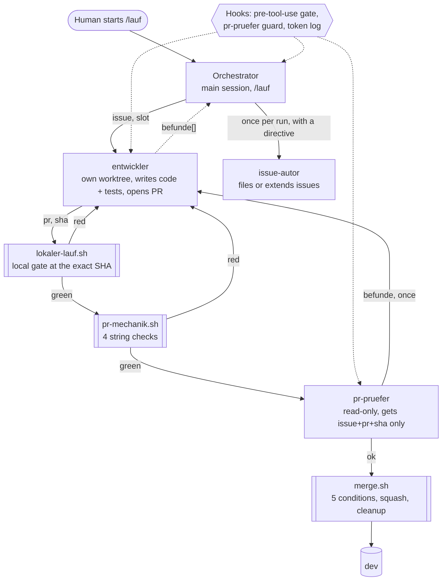

# Agent pipeline: issue → PR → review → merge with Claude Code

## What this is

The multi-agent setup a friend and I use to develop a web app we build together: a human starts one command,
and Claude Code subagents take open GitHub issues through implementation, independent review and
squash-merge, with hooks and scripts enforcing what prompts alone did not. This folder holds the
agent definitions, the orchestrator, the process skills, the hooks with their tests, excerpts of
the merge and gate scripts, and a cost analysis of the agents' token logs. Prompts stay in their
original German, every file adapted from the private project says so in its first lines, and in
the source project `agents/`, `commands/`, `skills/`, `hooks/` and `bin/` live under `.claude/`.

## Architecture

- **Orchestrator** ([`commands/lauf.md`](commands/lauf.md)) — the main session; picks candidate issues via a script, assigns two slots, keeps the retry counters, bundles findings, and writes no code.
- **entwickler** ([`agents/entwickler.md`](agents/entwickler.md)) — turns exactly one issue into one PR in its own git worktree, and reports anything outside the issue instead of building it.
- **Local gate** ([`bin/lokaler-lauf.sh`](bin/lokaler-lauf.sh), excerpt) — runs the CI commands in a throwaway worktree checked out at the PR's SHA and posts the result as a commit status itself.
- **pr-mechanik.sh** (not included) — does the four review checks that are pure string comparisons, so the reviewer is only called when those are green.
- **pr-pruefer** ([`agents/pr-pruefer.md`](agents/pr-pruefer.md)) — judges the diff against the issue's acceptance criterion; it cannot write, cannot run tests, and never sees the author's report.
- **issue-autor** ([`agents/issue-autor.md`](agents/issue-autor.md)) — turns the run's collected findings into new issues or extends existing ones, following the orchestrator's bundling directive.
- **merge.sh** ([`bin/merge.sh`](bin/merge.sh), excerpt) — checks five merge conditions, posts the reviewer's verdict verbatim, squash-merges and cleans up; it replaced an agent ([`agents/history/merge-waechter.md`](agents/history/merge-waechter.md)).
- **Hooks** ([`hooks/`](hooks/), registered in [`settings.json`](settings.json), tested in [`tests/test_hooks.py`](tests/test_hooks.py)) — a command-form gate for every agent, a write/test/metrics fence for the reviewer only, and a token logger on `SubagentStop` and `Stop`.
- **Process skills** ([`skills/`](skills/), overview in [`PROCESS-EXCERPT.md`](PROCESS-EXCERPT.md)) — each agent preloads only the sections it needs via `skills:` in its frontmatter.

## Design principles

**Author and reviewer are separate agents; the reviewer does not see the author's report.**
Origin: the project's prompts record that four times a review checked the author's arithmetic but
not the issue's promise, and each time the author's report was accurate — reading it made the
reviewer check inner consistency instead of outer correctness. The reviewer gets only
`{issue, pr, sha}` plus script measurements. A second incident (2026-09-07): an ordinary search by
the reviewer found the developer's closing report verbatim in a raw metrics log. Fix: the logger
stopped storing message content, and a hook fences the reviewer off `.claude/metrics/` on all four
of its tools (absence for new data, a fence for what was already on disk).

**The orchestrator never writes code.** This rule is in the first version of `/lauf`
(2026-09-02), not the result of a specific incident: "if you are tempted to do 'just one line'
yourself — that is exactly where the separation this setup is falls apart." The orchestrator holds
the whole run's context; if it edited, its changes would reach `dev` without the independent
review. The same reasoning keeps a run from building an issue its own issue-autor just filed.

**Judgement goes to a model, comparisons go to code.** The merge agent's own prompt said
"Ermessen ist dir **verboten**" (discretion is forbidden to you): every task was a comparison.
It still cost 13.4 % of the agent load over three measured runs, and it rejected a green PR
because its condition demanded `mergeable_state == "clean"` while the local gate produces
`"unstable"`. On 2026-09-05 it became `merge.sh`, with each condition a positive/negative test
pair. Candidate selection, waiting for CI and four of the eight review checks followed the same
route; the English squash subject (a translation of the issue title) stayed with the model.

**A hook checks form, never content; it verifies, it doesn't repair.** Hooks are string tests on
commands and paths; whether a change is correct is the reviewer's job. The first gate version
was "verified" by a hand-written table of 35 cases; review found four defects, including gates
that refused the reviewer's own `git diff … 2>/dev/null` and let
`git push origin HEAD:refs/heads/dev` through — now 129 regression test functions, most of them
parametrized, testing both directions (excerpt in `tests/`). On
the repair side: an automation that re-set issue labels was removed and replaced by checks at
two points that *report* skewed labels; the GitHub wrapper rejects a URL-shaped path instead of
fixing it; a failing cleanup step ends with exit 1 and the path, because a previous silent skip
had left branches behind after every merge.

**Two developers, two machines, two Claude accounts: coordination runs through GitHub, not
through anyone's local copy.** We each run the pipeline from our own machine and account against
one repository, and each side pushes to `dev` while the other is mid-session. Before the pipeline
existed this cost duplicate work twice in one afternoon (2026-08-26: the same package ID claimed
by both sides, and a feature built locally while an equivalent one was already on `origin/dev`).
What followed: GitHub issue numbers are the only IDs; the issue assignee is the reservation,
because it is the one thing the other person can see; every agent measures its checkout against
`origin/dev` before working and reports a gap, since rule files are copied into an agent's
context at start and do not update (on 2026-09-05 all four roles worked from an outdated rule
text without noticing); and commit identity is taken from the GitHub account instead of local
git config, after commits had gone out under a name that does not exist on GitHub. Usage limits
are per Claude account, so the budget check before each issue only sees the account it runs
under.

## Cost engineering findings

All numbers from the project's git history or its hook log (`agents.jsonl`, 2026-09-04 to
2026-10-09); full tables in [`cost-report.md`](cost-report.md). The log is local and not
committed, so it covers only the runs on my machine and Claude account, not my friend's.

- **A rules file without `paths:` is loaded into every agent turn, and it grew fast.**
  `.claude/rules/prozess.md` was 23 252 bytes on 2026-09-02, 128 542 bytes on 2026-09-12 and
  162 339 bytes on 2026-09-13 (git history). On 2026-09-17 it was split into twelve skills, each
  agent preloading only its own; on 2026-09-18 the per-agent text got a size budget held by a test.
- **Context per turn rose with it.** Median (input + cache read + cache write) per turn: reviewer
  62.6k tokens (2026-09-04, n=3) → 100.8k (2026-09-12, n=1), +61 %; issue author 60.9k (n=3) →
  103.9k (n=3), +71 %. Samples are small and context also depends on the task, so the size is
  indicative; the direction matches the rules growth.
- **The reviewer's start prefix shrank by about three quarters after the split.** First-turn
  context of the reviewer: 102 003 tokens in the last run before the split (2026-09-17),
  44 061 in the first run after it (same day), ~26 300 from 2026-09-23 on.
- **Cost is context, not generation.** Over all subagent runs, weighted cost is 56 % cache reads,
  41 % cache writes, 3 % output. Subagents read only 7–19 % of their first-turn prefix from cache
  (main session: 41 %), so most of every start is written fresh despite a 1h cache TTL.
- **Cost share per agent** (subagents, deduplicated by `agent_id`; weights: input 1, cache read
  0.1, cache write 2 for 1h / 1.25 for 5m, output 5; model price differences not applied):

| Agent | Runs | Turns/run | Cost share | Output share of own cost |
|---|---:|---:|---:|---:|
| entwickler | 59 | 105 | 71.3 % | 3.1 % |
| pr-pruefer | 79 | 20 | 15.1 % | 2.8 % |
| issue-autor | 40 | 29 | 11.5 % | 3.0 % |
| merge-waechter (until 2026-09-05) | 5 | 45 | 1.7 % | 3.9 % |
| general-purpose | 4 | 4 | 0.4 % | 0.8 % |

Since 2026-09-17, when top-level sessions are logged too, they account for 48.8 % of the
weighted total; the log does not separate `/lauf` orchestrator sessions from interactive ones.

## Risks and limitations

- **"Tests are green" from an agent is a claim.** The pipeline never uses it: the gate is run by
  the orchestrator's script in a fresh worktree at the exact SHA, posts its own commit status,
  checks that integration tests did not silently skip, and `merge.sh` refuses a status attached to
  any other SHA. Remaining risk: green only means as much as the test suite, and the reviewer
  judges whether a test actually covers the promise — a model judgement that can be wrong.
- **Prompt injection through issue text.** Issue bodies and comments are input to every agent,
  and the developer has Write and Bash. Mitigations limit the blast radius (no push to `dev`/`main`,
  a 13-form write allowlist for the GitHub API with no `DELETE`, a read-only reviewer, merges only
  through `merge.sh`), but nothing detects an injected instruction, and the reviewer reads the same
  issue. This is acceptable for a private repo with two people writing issues; it would not be for
  public issue input.
- **Hooks are not a sandbox.** They parse command strings with regular expressions and catch
  mistakes, not an adversary: a Python one-liner can write a file without matching any rule.
- **Meta loop.** Process tooling grew alongside the product: on 2026-10-09 the project has 8 694
  lines of shell in scripts and hooks, 2 322 lines of agent and skill text, and 50 of 182 test
  files (26 870 lines) testing the process, against 33 483 lines of backend application code.
  The size-budget test caps what agents load, not how much process exists.
- **No A/B measurements.** Every run builds a different issue on a moving `dev`, the model
  version changed during the period (visible in the log), and the logger itself changed three
  times. The findings above are before/after observations with small samples, not causal effects.
- **Data handling.** The token log stores counts and field names only, never message content, but
  local transcripts contain everything and all code is sent to the model provider; with client
  data this would need a separate review.

## What I would do next

1. **Replay benchmark:** re-run a fixed set of closed issues at pinned commits with and without a
   change (e.g. the skill split), to replace before/after observations with a controlled
   comparison of cost and outcome.
2. **Measure the reviewer:** label its past verdicts afterwards — were `befunde` real defects, did
   `ok` PRs need a fix later — to get precision and miss rate of the one judgement the pipeline
   depends on most.
3. **Treat issue text as untrusted input:** run the developer in a sandbox without network access
   beyond the API wrapper, and add a canary issue with an embedded instruction to the replay set.
