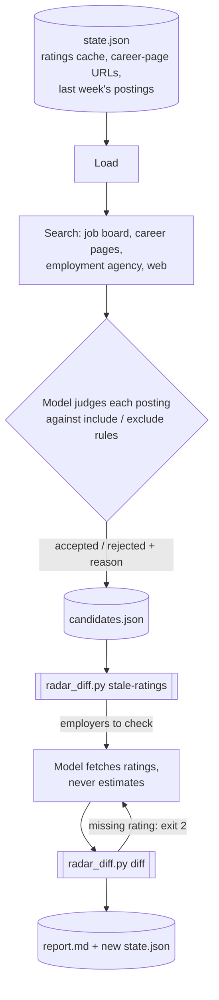

# Job-market radar: a weekly monitoring agent as a Claude skill

> **In short**
> - Once a week, an unattended Claude run searches job boards, career pages and the public employment agency for postings that match a configurable profile, checks how employees rate each employer, and reports what is new, still open or gone.
> - The model does what needs judgement (does this posting really involve data or AI work?) and code does every comparison, so the week-over-week diff is tested instead of trusted.
> - The same pattern fits any recurring monitoring task, such as tenders, regulatory changes or market news: search, judge, compare with last time, report with sources and gaps.

## What this is

I built this for my own job search, and it has been running as a weekly scheduled task
since late September 2026. It uses two MCP connectors (a job board and a scraping service) plus
web search, and publishes its result to one persistent page that I check each week.

This folder contains the skill instructions ([`skill/SKILL.md`](skill/SKILL.md), generalised from
my German task prompt), an example configuration, the comparison logic as a tested script
([`skill/scripts/radar_diff.py`](skill/scripts/radar_diff.py), 26 tests in [`tests/`](tests/)) and a
full example run on **fictional** data in [`examples/`](examples/). The weekly run uses exactly this
script: it is stored next to the published page together with the state file, each run downloads
both, and the model renders the page from the script's JSON output. Until October 2026 the model
did these comparisons itself from a JSON block embedded in the page; I moved them into code for
the reasons below.

## How a run works



| Step | Model | Script |
|---|---|---|
| Search and read postings | ✓ | |
| Does the role involve real data or AI work? Why does it fit? | ✓ | |
| Is an employer's rating missing or older than 28 days? | | ✓ |
| Merging this run's ratings into the cache without losing older values | | ✓ |
| Is this the same posting as one found via another source? | | ✓ |
| New, still open or gone since last week? | | ✓ |
| Warning flags from configurable thresholds (rating, recommendation rate, CEO approval, number of reviews), on both platforms | | ✓ |
| Sort order and report | | ✓ |

## What running it taught me

- **A URL is not an identity.** The job board hands out a different short link for the same
  posting on every call; I saw several different links for one posting within a few days.
  Matching on the link would report the same job as "new" every week. The script matches on
  link *or* a normalised company + title key (gender tags, case and punctuation removed), and
  a test pins exactly this case.
- **Old postings come back.** Web search surfaced a posting from 2025 that job portals listed as
  closed. Every posting needs a date and an "is it still online" check, and when no date can be
  found the report says "not found" instead of guessing.
- **Not every page is readable, and that is fine.** Some career pages sit behind a CAPTCHA, and
  the employment agency's REST API was not reachable from the sandbox. The agent does not try to
  get around either; it uses the public search page instead, or names the gap in the report.
- **One rating source is not enough.** For one employer, 84 % recommended it on one platform
  and 49 % on another. Ratings carry an optional second platform, and the script checks the
  thresholds on both.
- **Cost needs a hard limit.** Each scrape costs credits, so a run has a budget of 40 scrapes,
  ratings are cached for 28 days, and career-page URLs that worked are stored and reused.

## Risks and limitations

- **Prompt injection.** Every page the agent reads is written by a third party. The skill tells
  the model to treat page content as data and to report text that addresses it, but nothing
  enforces this. The blast radius is small because the agent only reads and writes a report; it
  sends nothing and applies nowhere.
- **The relevance judgement is unmeasured.** Whether a posting "really involves data or AI work"
  is the model's call. Rejected postings are listed with a reason so I can spot wrong calls, but
  I have no precision or recall figures yet.
- **Ratings are a proxy.** Employer-review sites are self-selected and small employers often have
  only a handful of reviews, which the report flags rather than hides.
- **Scraping etiquette.** Low volume, public pages only, a fixed budget, no logins, no CAPTCHA
  workarounds.

## What I would do next

1. **Labelled evaluation set:** mark 50 past postings by hand as fit / no fit and measure how often
   the model's include / exclude call agrees, before trusting it with more autonomy.
2. **Still-online check in code:** request each known posting once per run and treat a 404 or a
   "position filled" page as gone, instead of relying on it not reappearing in search.
3. **Canary posting:** add a fake posting with an embedded instruction to the evaluation set to
   test whether the model follows it.

## Try it

```bash
cd job-market-radar
python3 skill/scripts/radar_diff.py diff --state examples/state.json \
  --candidates examples/candidates.json --ratings examples/ratings_new.json \
  --today 2026-10-09 --out /tmp/state.json --report /tmp/report.md
python3 -m pytest tests        # needs pytest; the script itself uses the standard library only
```

All companies, links and ratings in `examples/` are invented.
